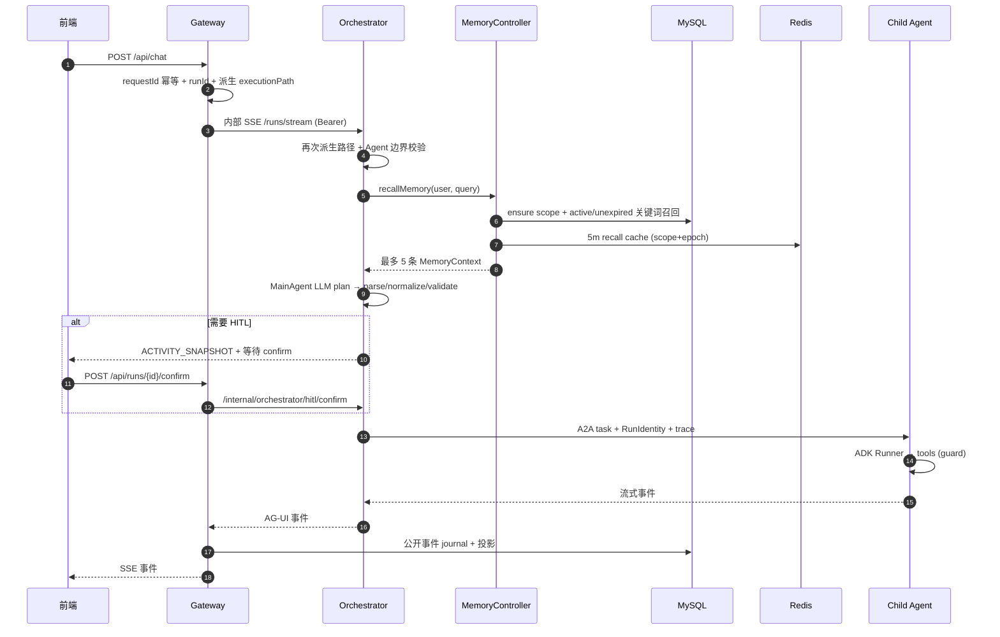
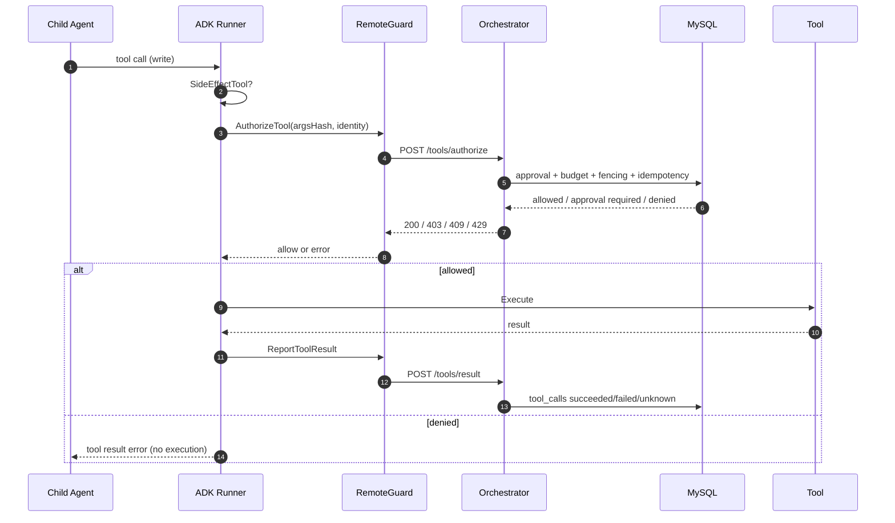
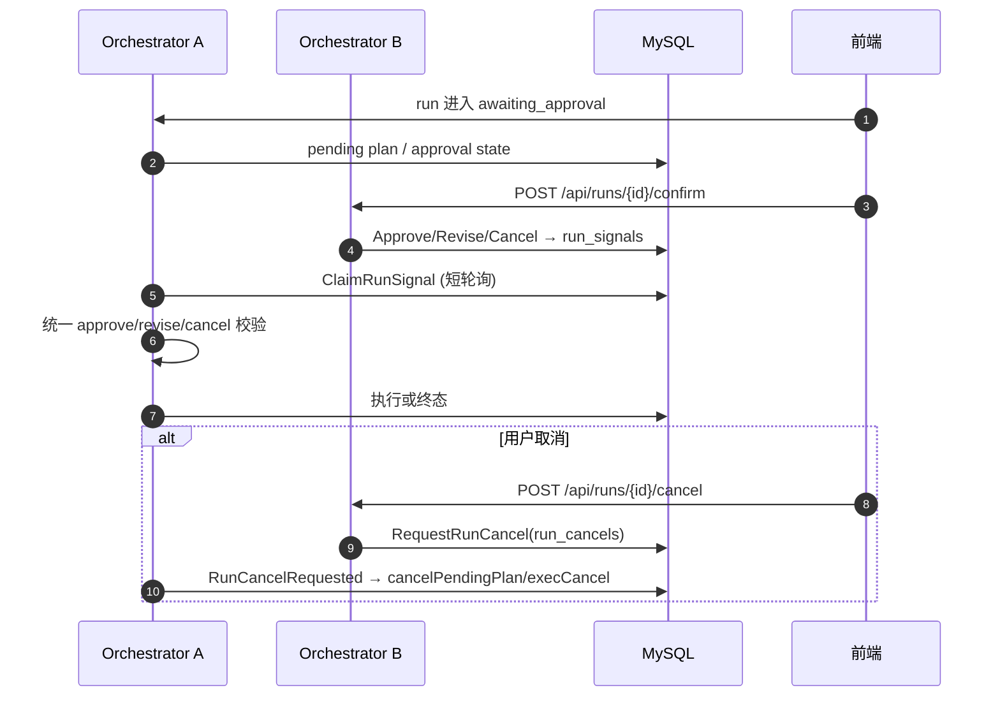
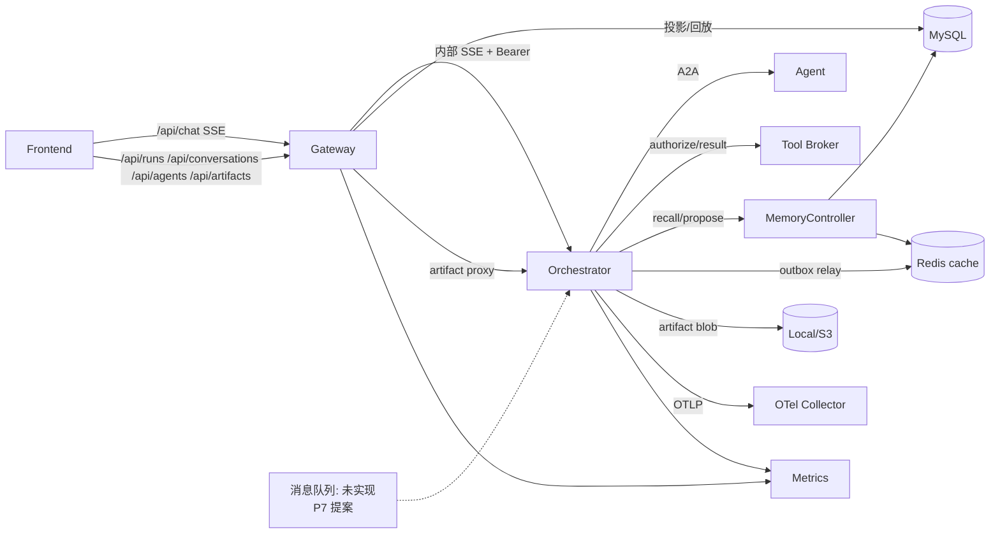
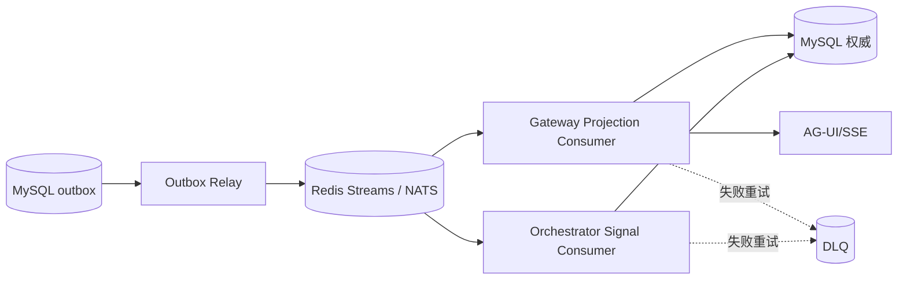

# AgentHub v3：缺口清单与测试覆盖计划

- 日期：2026-11-02
- 状态：**测试计划，不是测试通过报告**
- 范围：A0–A6 已落地部分、P7 提案、短/长期记忆、前后端联调与消息流
- 关联：`docs/plans/v3-atomic-implementation-plan.md`、`docs/architecture/v3/18-message-queue-and-rich-interactions.md`、`docs/architecture/v3/19-short-long-term-memory.md`

## 1. 目的

把“已实现、未验证、未实现”分开，避免用单测绿色或文档存在替代运行认证。本文回答四个问题：

1. 现在缺什么、哪些没有真实测试；
2. 后续测试要覆盖哪些场景；
3. 每条消息如何串联、如何记录证据；
4. 短期/长期记忆还要补什么。

状态图例：

| 标记 | 含义 |
|---|---|
| `PASS` | 本机有可复现命令且已执行 |
| `PARTIAL` | 有单测/局部验证，但缺少真实 MySQL/Redis/Docker/E2E |
| `SKIP` | 因环境缺失未执行，**不算通过** |
| `MISSING` | 没有实现或没有对应测试 |

## 2. 结论摘要

- A0–A6 原子任务已落地，但 **G1–G6 未整体认证**：MySQL/Redis 集成、Docker 运行、GitHub CI、MinIO/OTel collector/Alertmanager 未实跑。
- P7 消息队列与富交互渲染是**提案**：Redis Streams/NATS、Streamdown/Sandpack/RJSF/图表均未实现。
- 短期记忆已有窗口/截断/pinned/预算；**自动摘要未接入**。
- 长期记忆骨架已有（MySQL + policy + controller + Redis cache + 前端面板），默认关闭；**自动提取、向量召回、purge worker、真实集成测试缺失**。
- 当前最优先补的不是新功能，而是：
  1. 真实 MySQL/Redis 集成；
  2. 工具写审批/unknown/恢复；
  3. SSE 断线重连与 Gateway 重启；
  4. 记忆 scope 隔离、token 预算与自动提取；
  5. P7 MQ 的重复/崩溃/DLQ 测试。

## 3. 缺口清单

### 3.1 P0：不补就不能宣称生产可用

| ID | 缺口 | 当前证据 | 为什么不算通过 | 验证方式 |
|---|---|---|---|---|
| GAP-01 | MySQL 集成 | 许多 `TestIntegration*` 本机 SKIP；CI 工作流已配置 | 没有真实 DSN；SQL/迁移/租约/审批未运行 | `AGENTHUB_MYSQL_TEST_DSN=... go test ./services/orchestrator/... ./services/gateway/... -run TestIntegration` |
| GAP-02 | Redis 集成 | 本机 SKIP | 没有真实 Redis；cache/relay/PEL 未验证 | `AGENTHUB_REDIS_TEST_ADDR=...` + 集成测试 |
| GAP-03 | Docker 构建/运行 | 仅 Dockerfile 静态审计、Linux 交叉构建 | 未构建镜像、未起 compose；卷权限/网络未知 | `docker compose -f docker-compose.new-arch.yml up --build` + smoke |
| GAP-04 | GitHub CI | workflow + actionlint | 未在 GitHub 实跑 | push/PR 后检查 `V3 Integration Gates` |
| GAP-05 | 多副本运行时 | 内存共享 store 测试 + MySQL 集成测试代码 | 未真实起 2 个 Orchestrator/2 个 Gateway | compose scale/独立进程 + cancel/confirm/projection |
| GAP-06 | S3/MinIO 运行 | fake S3 + S3Store 单测 | 未接真实 MinIO/多副本 | MinIO 容器 + 跨实例读写/Presign |
| GAP-07 | OTel collector/Alertmanager | collector config validate | span 未真实导出；告警未送达 | `observability` profile + Jaeger/Prometheus/Alertmanager |
| GAP-08 | Docker 内 Playwright | 本机 Edge 渲染通过 | 未在镜像沙箱内执行 | 构建含 Node/Playwright 的 orchestrator 镜像 + render smoke |

### 3.2 P1：功能/质量缺口

| ID | 缺口 | 当前状态 | 影响 | 建议 |
|---|---|---|---|---|
| GAP-10 | 消息队列 | 未实现；P7 提案 | 仍靠 SQL 轮询/outbox relay | 先 Redis Streams adapter + 幂等消费 |
| GAP-11 | 富交互 HTML/组件 | 未实现；P7 提案 | 只有固定卡片/iframe 预览 | 沙箱 HTML + RJSF + 图表；Sandpack 单独评审 |
| GAP-12 | 自动记忆提取 | 未实现 | 长期记忆不会自动积累 | 从会话/工具结果生成 candidate，必须用户确认 |
| GAP-13 | 向量/混合召回 | 未实现；仅关键词 INSTR | 同义表达召回差 | 先评估 embedding + 混合排序，不直接替换 |
| GAP-14 | purge worker | `purge_status=pending`，无 worker | “忘记”只停止召回，不物理清理 | 增加可审计 purge 任务与状态机 |
| GAP-15 | 自动上下文摘要 | `context-agent` 未接主链路 | 长会话只能窗口/截断 | 真实 token 计数 + 可选摘要 + 回滚 |
| GAP-16 | MCP 审计接线 | adapter/allowlist 有，未接具体 Agent | 无法证明工具调用可追溯 | Agent 配置 MCP + Tool Broker 结果账本 |
| GAP-17 | Agent 健康过滤 | Picker 过滤 disabled；健康未参与选择 | 不健康 Agent 仍可能被选 | 统一 enabled/healthy 语义 + 测试 |
| GAP-18 | 执行中动态选发言人 | 目前是计划期选择 | 群聊不能依据输出改选 | 先做受控动态 re-select，不做自由 swarm |
| GAP-19 | markdown-agent 部署 | 模块可用，未加入 compose | 默认部署无导出能力 | 加入 compose/注册表或保持显式 opt-in 文档 |
| GAP-20 | artifact 自动 UI 事件 | 前端可渲染卡片，但渲染工具不自动发 artifact 事件 | 用户可能看不到截图/PDF | 定义 artifact 事件映射与测试 |
| GAP-21 | 规则/契约字段未用 | `MaxCoreEntries`、`DefaultRecheckAfter` 无调用点 | 策略承诺大于实现 | 接线或从文档中标记为预留 |

### 3.3 P2：测试深度与运维

- 负载/并发/长上下文压测；
- 混沌：Redis 重启、MySQL 短断连、consumer/worker kill；
- 安全矩阵：prompt injection、跨 scope、日志脱敏、auth 矩阵；
- 浏览器矩阵、可访问性、移动端；
- 真实 LLM provider 矩阵（不同模型工具调用差异）；
- 告警通道与值班演练；
- 成本/预算回归（模型 token、工具输出、artifact 大小）。

## 4. 当前测试证据快照

| 证据 | 结果 | 边界 |
|---|---|---|
| Go 各模块 `go test` + build | PASS | `pkg/runtime/launcher` 在本机 `go test` 启动被策略拒绝；直接运行测试产物 10/10 PASS |
| 前端 `vitest` | 28 files / 257 tests PASS | 组件/状态层，不是浏览器全链路 |
| 前端 `tsc + vite build` | PASS | 首屏 gzip 约 156.9KB |
| Playwright 群聊 E2E | 1 passed | API 是浏览器内 mock；不是真实 Gateway/Orchestrator |
| 真实 Edge render→artifact→content | PASS | 本机 Edge，不是 Docker 沙箱 |
| 跨实例 HITL / 待审批 cancel | PASS | 共享内存 store；MySQL 版本 SKIP |
| 双 worker 投影 | PASS | 内存 store；MySQL 版本 SKIP |
| sandbox fail-closed | PASS | Docker 不可用；真实容器执行 SKIP |
| promtool/nginx/otelcol 配置 | PASS | 静态配置校验；未启动服务 |
| Dockerfile/CA/go.sum/Linux build 审计 | PASS | 未构建镜像 |

## 5. 消息流与联调图

### 5.1 当前主链路（含记忆召回）



### 5.2 工具写调用与审批



### 5.3 跨实例 HITL / 取消



### 5.4 当前集成拓扑



### 5.5 P7 目标：MQ 与投影



## 6. 测试矩阵

### 6.1 主流程

| ID | 场景 | 预期 | 当前状态 | 备注 |
|---|---|---|---|---|
| F-01 | 单 Agent 普通对话 | SSE 完整、消息落库、无重复 | `PARTIAL` | 有单测/群聊 E2E；缺真实后端浏览器 E2E |
| F-02 | 群聊创建→多选→发送→取消→刷新 | 参与者恢复、逐轮历史、取消 | `PASS` | Playwright + mock API |
| F-03 | HITL approve | 继续执行、参与者过滤 | `PARTIAL` | 单测；缺真实 MySQL/E2E |
| F-04 | HITL revise | 新 revision、旧计划不执行 | `PARTIAL` | 单测 |
| F-05 | HITL cancel | 待审批/执行中均终止 | `PARTIAL` | 内存跨实例 PASS；MySQL SKIP |
| F-06 | 跨实例 confirm | B 写 signal，A 消费 | `PARTIAL` | 内存 PASS；MySQL SKIP |
| F-07 | 工具写审批 allow/deny/unknown | 未审批 0 执行；unknown 不重试 | `PARTIAL` | 单测；真实 SQL SKIP |
| F-08 | 取消传播到 A2A | 远端 task 取消、无悬挂 | `PARTIAL` | 单测/refs；真实 Agent 未跑 |
| F-09 | 断线后 events/status → resume | 无事件缺口、终态可查 | `PARTIAL` | 单测；真实 SSE/E2E 缺 |
| F-10 | Gateway 重启 | 投影 worker 接管 | `PARTIAL` | 内存双 worker；MySQL SKIP |
| F-11 | Orchestrator 崩溃/lease 接管 | 新实例接管、不双执行 | `PARTIAL` | 单测；进程级缺 |
| F-12 | artifact 生成→内容读取 | checksum/认证/跨节点 | `PASS`（本机） | 本机 render；S3 多副本未跑 |
| F-13 | 重复 requestId | 只接受一次 | `PARTIAL` | 单测；MySQL SKIP |
| F-14 | 群聊参与者过滤 | 未确认成员不派发 | `PASS`（单测） | 缺真实群聊 E2E |

### 6.2 记忆专项

| ID | 场景 | 预期 | 当前状态 |
|---|---|---|---|
| M-01 | 空历史 | 不崩、只用当前消息 | `PASS`（单测） |
| M-02 | head 20/tail 4 | 保留两端、顺序不变 | `PASS`（单测） |
| M-03 | pinned 命中/缺失 | 命中保留、缺失仅 warning | `PASS`（单测） |
| M-04 | pinned 超 hard limit | 明确失败，不静默丢弃 | `PARTIAL` |
| M-05 | 工具调用/结果对 | 保留配对、孤立结果丢弃 | `PASS`（单测） |
| M-06 | 前端 100 条 + Load earlier | 首条后移、历史仍在 | `PASS`（单测） |
| M-07 | `off/session_only` | 不召回长期记忆 | `PASS`（单测） |
| M-08 | `scoped_long_term` 召回 | 只召回 active/未过期 | `PARTIAL`（MySQL SKIP） |
| M-09 | candidate | 永不召回 | `PASS`（单测） |
| M-10 | confirm 过期/revision 冲突 | 拒绝并给出稳定错误 | `PARTIAL`（MySQL SKIP） |
| M-11 | scope 隔离 | 不跨 principal/workspace | `PARTIAL` |
| M-12 | token/entry 预算 | 2048 tokens、4096 bytes 生效 | `PASS`（单测） |
| M-13 | Redis epoch | mutation 后旧 cache 不命中 | `PARTIAL`（真实 Redis SKIP） |
| M-14 | forget/forget-scope | 停止召回、purge pending | `PARTIAL`（真实 MySQL SKIP） |
| M-15 | 自动提取 | 会话产生 candidate | `MISSING` |
| M-16 | 记忆 prompt injection | 只作为 data，不执行指令 | `MISSING` |
| M-17 | 向量/同义召回 | 目标能力 | `MISSING` |
| M-18 | purge worker | 物理清理可审计 | `MISSING` |

### 6.3 安全 / 故障 / 性能

| ID | 场景 | 预期 | 当前状态 |
|---|---|---|---|
| S-01 | Markdown/HTML XSS | 0 执行 | `PASS`（单测） |
| S-02 | iframe 同源逃逸 | 不可读父页 | `PARTIAL`（交互 HTML 未实现） |
| S-03 | link/render SSRF | 私网/metadata 0 请求 | `PASS`（单测） |
| S-04 | 日志/错误密钥泄漏 | 不出现 token/DSN | `PARTIAL` |
| S-05 | auth 矩阵 | 无 token 401、服务 token 通过 | `PARTIAL` |
| S-06 | prompt injection（消息/记忆/工具输出） | 不越权、不泄密 | `MISSING` |
| S-07 | 工具 allowlist/审批 | 非白名单 0 执行 | `PASS`（单测） |
| P-01 | 50 并发 run | 不超并行上限、无重复 | `MISSING` |
| P-02 | 120k 上下文 | 确定性裁剪/拒绝 | `PARTIAL`（单测） |
| P-03 | Redis 不可用 | 退避、MySQL 仍权威 | `MISSING` |
| P-04 | MySQL 短断连 | 明确失败/恢复 | `MISSING` |
| P-05 | SSE 慢客户端 | 不拖垮 Gateway | `MISSING` |
| P-06 | consumer kill | 重投/claim | `MISSING`（MQ 未实现） |

### 6.4 P7 消息队列 / 富交互

| ID | 场景 | 预期 | 当前状态 |
|---|---|---|---|
| MQ-01 | 重复发布同一 eventId | 业务效果一次 | `MISSING` |
| MQ-02 | consumer ack 前崩溃 | 重新投递 | `MISSING` |
| MQ-03 | Redis 重启 | 未 ack 消息可恢复 | `MISSING` |
| MQ-04 | 超过 maxAttempts | 进 DLQ、不自动重放 | `MISSING` |
| MQ-05 | 同 run 顺序 | 单消费者有序 | `MISSING` |
| MQ-06 | outbox/Redis 故障 | outbox 不丢、可恢复 | `MISSING` |
| UI-01 | 未闭合 Markdown 流 | 不崩、可回滚 | `MISSING` |
| UI-02 | sandbox HTML XSS/父页访问 | 0 执行/不可读 | `MISSING` |
| UI-03 | Sandpack 首屏/依赖 | 不进首屏、可卸载 | `MISSING` |
| UI-04 | RJSF schema 注入 | 字段白名单/校验 | `MISSING` |
| UI-05 | 图表超限 | 明确拒绝、不执行 JS | `MISSING` |
| UI-06 | 未知组件 | 降级文本卡片 | `MISSING` |

## 7. 消息流记录规范

每条测试必须能还原“消息从哪来、到哪去、发生了什么”。建议记录 JSONL（每行一个事件），不要记录 prompt/密钥。

```json
{
  "testId": "F-02",
  "requestId": "req_...",
  "runId": "run_...",
  "conversationId": "conv_...",
  "traceId": "trace_...",
  "seq": 12,
  "subIndex": 0,
  "type": "AGENT_TURN_FINISHED",
  "agentName": "code-agent",
  "taskId": "task_...",
  "status": "completed",
  "errorCode": "",
  "artifactId": "",
  "memoryIds": [],
  "recordedAt": "2026-11-02T00:00:00Z"
}
```

采集点：

| 层 | 记录内容 |
|---|---|
| Frontend | requestId、SSE 事件类型、reducer 后消息/卡片、错误展示 |
| Gateway | 公开事件 journal、SSE 写错误/断连、run status、投影 offset |
| Orchestrator | plan、route_decisions、HITL signal、tool ledger、memory recall 摘要（只记 ID/数量） |
| Child Agent | A2A task、tool call/result 状态、sandbox 结果 |
| Middleware | outbox/relay、Redis cache hit/miss、队列 pending/DLQ（P7） |

证据目录建议：

```text
docs/reports/evidence/2026-11-02/F-02/
  events.jsonl
  summary.md
  commands.txt
  screenshots/       # 可选，不含密钥
```

禁止：真实 `.env`、token、DSN、完整 prompt、用户隐私原文、原始工具参数中的密钥。

## 8. 执行顺序

1. **静态/单元**：Go、前端、schema、Dockerfile/配置审计（已大部分 PASS）。
2. **真实中间件**：MySQL/Redis 集成 → 跨实例 HITL/cancel → 投影/回放。
3. **浏览器 E2E**：真实 Gateway/Orchestrator + 真实/沙箱 Agent；覆盖 HITL、断线、resume、artifact。
4. **故障注入**：Redis/MySQL/consumer/Gateway 崩溃；记录恢复时间与终态。
5. **安全**：XSS/SSRF/prompt injection/auth 矩阵/日志脱敏。
6. **P7**：EventBus 契约 → Redis Streams → 幂等/claim/DLQ → UI 白名单/沙箱。

## 9. Definition of Done

- 每个场景都有 `testId`、可复现命令、期望结果、实际结果、证据文件。
- 任何 `SKIP` 必须写环境原因，不得计入通过。
- 真实 MySQL/Redis 路径必须至少跑一次；Docker/CI 未跑则明确写“未认证”。
- 记忆测试必须覆盖 scope 隔离、candidate/confirm、token 预算、cache epoch、forget/purge 语义。
- 消息流证据能按 `runId + traceId` 串联 Gateway/Orchestrator/Agent/工具/记忆。
- P7 未实现前，不得在完成度或演示中宣称“已有消息队列/交互式 HTML”。

## 10. 相关文档

- `docs/architecture/v3/19-short-long-term-memory.md`：短期/长期记忆现状与目标。
- `docs/architecture/v3/18-message-queue-and-rich-interactions.md`：P7 MQ/富交互选型。
- `docs/plans/v3-atomic-implementation-plan.md`：A0–A6 证据与门禁。
- `docs/contracts/event-replay.md`、`docs/contracts/redis-usage.md`、`docs/contracts/artifact-schema.md`。
